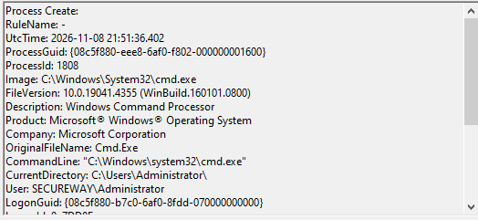
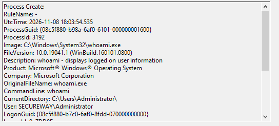
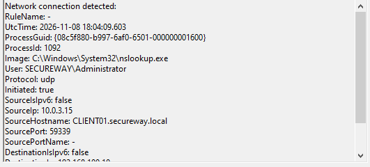
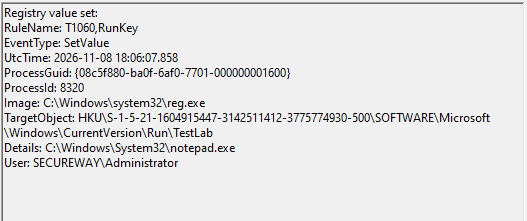

# Sysmon Endpoint Investigation Lab

This lab demonstrates how Sysmon captures endpoint telemetry generated by common Windows activities. The objective is to investigate the collected events and reconstruct user activity using Sysmon logs.

## Objectives

- Generate endpoint telemetry using common Windows commands.
- Investigate Sysmon Event IDs 1, 3, 11, 13 and 22.
- Correlate events into a timeline.
- Map observed activity to MITRE ATT&CK.

## Performed activities

## Process Creation

## DNS Activity

**Network**    |  **Activity**
Destination	  Process	Event
github.com   	ping.exe	3

## Registry 

## MITRE ATT&CK Mapping
**Activity**	| **Event**	   | **Technique**
Command Execution	  1     T1059
DNS Query       	  22	  T1071.004
Network Connection	3	    T1071
Registry Modification	13	T1112

